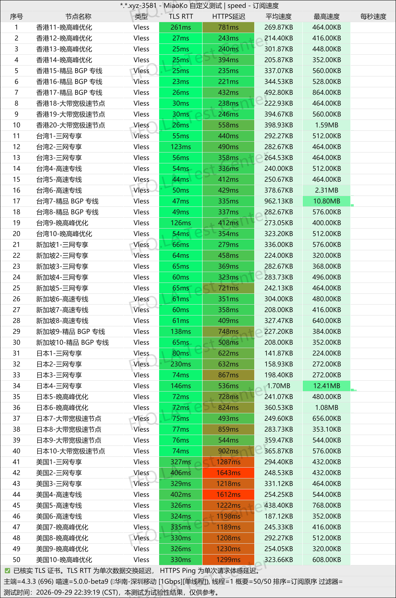
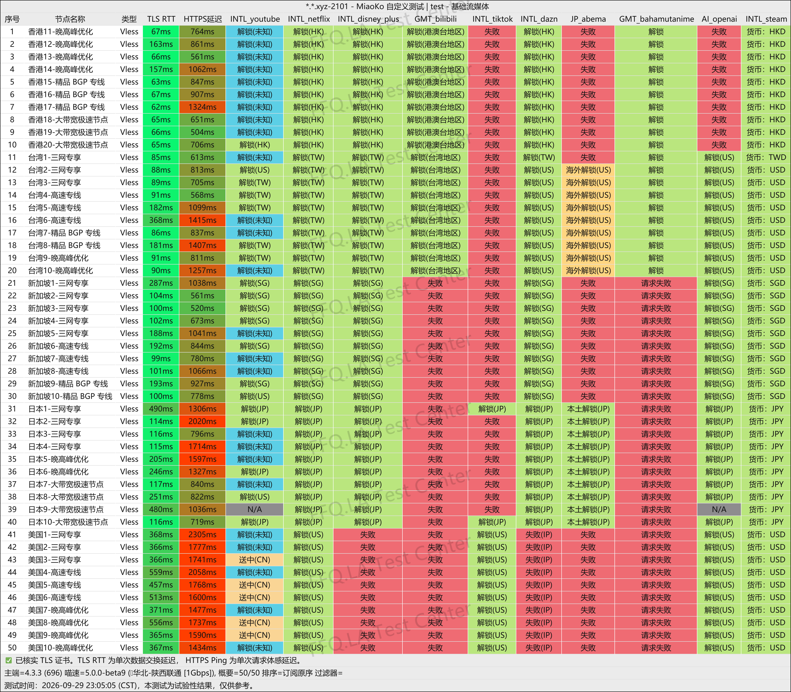
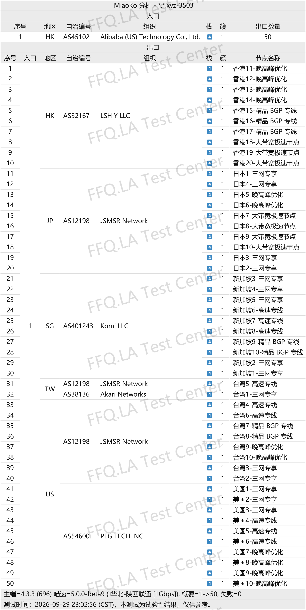

🇨🇳 [中文](README.md) | 🇺🇸 English | 🇷🇺 [Русский](README_RU.md) | 🇮🇷 [فارسی](README_FA.md)

# ShenXing VPN Official Website (Updated November 9, 2026)

ShenXing VPN Official Website<br>
✅ Only supports the official client application<br>
Official Website: [8538vip.shenxingaff.com](https://to.iix.im/sx01)<br>

2026 Best VPN Recommendations and Proxy Node Sharing: [https://github.com/jdnei/JiChangTuiJian](https://github.com/jdnei/JiChangTuiJian)<br>

## Telegram VPN Community #AD

[VPN Giveaway Group](https://331024.de/archives/choujiang) | [VPN Chat Group](https://331024.de/archives/choujiang) | [VPN Trial Group](https://331024.de/archives/choujiang)<br>

[https://331024.de/archives/choujiang](https://331024.de/archives/choujiang)

## Invitation Code

```bash
YpE2akcR
```

## Coupon Code / Discount Code

`30% OFF, expiration date unknown`

```bash
sx0077
```

## Introduction

ShenXing VPN is a network acceleration service designed for everyday internet browsing, streaming entertainment, and international online activities. It offers proxy nodes in multiple regions, including Hong Kong, Taiwan, Japan, Singapore, and the United States.

Its subscription plans accommodate both light and heavy data usage, with monthly and annual payment options. ShenXing is suitable for individuals, users with multiple devices, and those seeking a long-term VPN solution.

## Advantages

ShenXing VPN focuses on IPLC / IEPL dedicated network connections. All nodes use a 1× traffic multiplier, and subscription plans have no device limits. Multiple traffic allowances are available to meet different needs.

Some publicly available information indicates that individual nodes can reach peak speeds of up to 2.5 Gbps. The service also supports popular streaming platforms such as Netflix, Disney+, and YouTube, as well as AI services including ChatGPT, Gemini, and Claude.

ShenXing can only be used through its `official client application`, which is intended to provide greater connection stability.

## Subscription Plans

| Plan | Traffic | Devices | Speed | Monthly Price | Annual Price | Traffic Reset | Connection Type | Nodes / Features | Recommended For |
|---|---:|---:|---:|---:|---:|---|---|---|---|
| ShenXing · Starter | 120 GB/month | Unlimited | Unlimited | ¥23 | — | Monthly reset | Full IPLC dedicated lines | All nodes 1× traffic multiplier; no speed throttling during evening peak hours; up to 2.5 Gbps peak speed per node; native IPs; Hong Kong ×20, Taiwan ×10, Japan ×10, Singapore ×10, United States ×10, etc. | Academic research, social communication, everyday VPN usage, and 4K / HDR streaming |
| ShenXing · Basic | 260 GB/month | Unlimited | Unlimited | ¥40 | — | Monthly reset | Full IPLC dedicated lines | All nodes 1× traffic multiplier; no speed throttling during evening peak hours; up to 2.5 Gbps peak speed per node; native IPs; Hong Kong ×20, Taiwan ×10, Japan ×10, Singapore ×10, United States ×10, etc. | Large downloads, multiple devices, and traffic routing through software routers |
| ShenXing · Premium | 520 GB/month | Unlimited | Unlimited | ¥72 | — | Monthly reset | Full IPLC dedicated lines | All nodes 1× traffic multiplier; no speed throttling during evening peak hours; up to 2.5 Gbps peak speed per node; native IPs; Hong Kong ×20, Taiwan ×10, Japan ×10, Singapore ×10, United States ×10, etc. | Heavy downloading, multi-device routing, high-end gaming, studios, and demanding users |
| ShenXing · Annual Special | 60 GB/month | Unlimited | Unlimited | — | ¥96 | Automatically resets every 30 days | IEPL dedicated lines · VLESS | All nodes 1× traffic multiplier; no speed throttling during evening peak hours; native IPs; 50+ nodes; supports Netflix, Disney+, YouTube, etc. | Light users and beginners; equivalent to approximately ¥8/month |

## 📊 Performance Tests and Analysis

#### 1. Evening Peak-Hour Speed Test

<br>

#### 2. Streaming Platform Unblocking Report

<br>

#### 3. Entry and Exit Node Analysis

<br>
