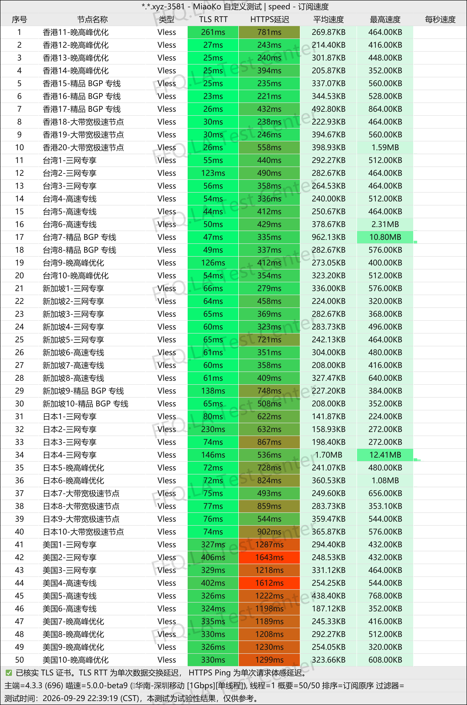
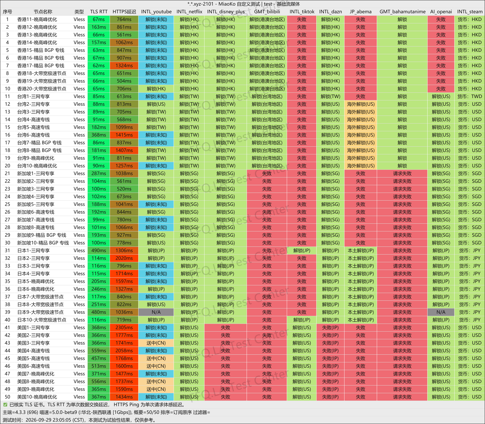
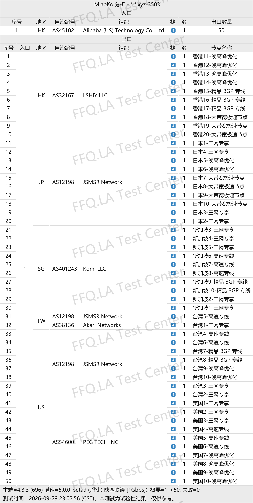

 🇨🇳 [中文](README.md) | 🇺🇸 [English](README_EN.md) | 🇷🇺 [Русский](README_RU.md) | 🇮🇷 فارسی

# آدرس رسمی فیلترشکن ShenXing (به‌روزرسانی 5 نوامبر 2026)
وب‌سایت رسمی فیلترشکن ShenXing<br>
✅ فقط از طریق اپلیکیشن اختصاصی قابل استفاده است<br>
آدرس رسمی: [8538vip.shenxingaff.com](https://to.iix.im/sx01)<br>

معرفی بهترین سرویس‌های VPN و اشتراک‌گذاری سرورهای پروکسی در سال ۲۰۲۶: [https://github.com/jdnei/JiChangTuiJian](https://github.com/jdnei/JiChangTuiJian)<br>

## انجمن تلگرامی VPN #AD

[گروه قرعه‌کشی VPN](https://331024.de/archives/choujiang) | [گروه گفت‌وگوی VPN](https://331024.de/archives/choujiang) | [گروه تست رایگان VPN](https://331024.de/archives/choujiang)<br>

[https://331024.de/archives/choujiang](https://331024.de/archives/choujiang)

## کد دعوت

```bash
YpE2akcR
```

## کد تخفیف

`۳۰٪ تخفیف، تاریخ انقضا نامشخص`

```bash
sx0077
```

## معرفی

ShenXing یک سرویس VPN و شتاب‌دهنده شبکه است که برای وب‌گردی روزمره، تماشای فیلم و سریال و استفاده از خدمات اینترنتی بین‌المللی طراحی شده است.

این سرویس سرورهایی در مناطق مختلف از جمله هنگ‌کنگ، تایوان، ژاپن، سنگاپور و ایالات متحده ارائه می‌دهد.

طرح‌های اشتراک آن از مصرف کم تا حجم بالای اینترنت را پوشش می‌دهند و امکان پرداخت ماهانه یا سالانه را فراهم می‌کنند. ShenXing برای کاربران شخصی، دارندگان چندین دستگاه و افرادی که به اتصال پایدار و بلندمدت نیاز دارند، مناسب است.

## مزایا

ShenXing بر استفاده از خطوط اختصاصی IPLC / IEPL تمرکز دارد. تمام سرورها دارای ضریب مصرف ترافیک ۱ برابر هستند و محدودیتی در تعداد دستگاه‌های متصل وجود ندارد.

این سرویس بسته‌های مختلفی با حجم ترافیک متفاوت ارائه می‌دهد.

بر اساس برخی اطلاعات منتشرشده، حداکثر سرعت هر سرور می‌تواند به ۲.۵ گیگابیت بر ثانیه برسد.

همچنین امکان دسترسی به سرویس‌های پخش آنلاین مانند Netflix، Disney+ و YouTube و ابزارهای هوش مصنوعی از جمله ChatGPT، Gemini و Claude فراهم شده است.

استفاده از ShenXing فقط از طریق `اپلیکیشن اختصاصی` آن امکان‌پذیر است؛ این روش با هدف افزایش پایداری اتصال ارائه می‌شود.

## طرح‌های اشتراک

| طرح | حجم ترافیک | تعداد دستگاه | محدودیت سرعت | قیمت ماهانه | قیمت سالانه | بازنشانی ترافیک | نوع اتصال | سرورها و ویژگی‌ها | مناسب برای |
|---|---:|---:|---:|---:|---:|---|---|---|---|
| ShenXing · Starter | 120 گیگابایت در ماه | نامحدود | بدون محدودیت | ¥23 | — | بازنشانی ماهانه | خطوط اختصاصی IPLC | ضریب مصرف ۱ برابر برای تمام سرورها؛ بدون کاهش سرعت در ساعات اوج شب؛ حداکثر سرعت هر سرور ۲.۵ گیگابیت بر ثانیه؛ IP بومی؛ هنگ‌کنگ ۲۰ سرور، تایوان ۱۰، ژاپن ۱۰، سنگاپور ۱۰، آمریکا ۱۰ و سایر مناطق | تحقیقات علمی، شبکه‌های اجتماعی، استفاده روزمره از VPN و تماشای ویدئوهای 4K / HDR |
| ShenXing · Basic | 260 گیگابایت در ماه | نامحدود | بدون محدودیت | ¥40 | — | بازنشانی ماهانه | خطوط اختصاصی IPLC | ضریب مصرف ۱ برابر برای تمام سرورها؛ بدون کاهش سرعت در ساعات اوج شب؛ حداکثر سرعت هر سرور ۲.۵ گیگابیت بر ثانیه؛ IP بومی؛ هنگ‌کنگ ۲۰ سرور، تایوان ۱۰، ژاپن ۱۰، سنگاپور ۱۰، آمریکا ۱۰ و سایر مناطق | دانلودهای حجیم، استفاده هم‌زمان از چند دستگاه و مدیریت ترافیک با روتر نرم‌افزاری |
| ShenXing · Premium | 520 گیگابایت در ماه | نامحدود | بدون محدودیت | ¥72 | — | بازنشانی ماهانه | خطوط اختصاصی IPLC | ضریب مصرف ۱ برابر برای تمام سرورها؛ بدون کاهش سرعت در ساعات اوج شب؛ حداکثر سرعت هر سرور ۲.۵ گیگابیت بر ثانیه؛ IP بومی؛ هنگ‌کنگ ۲۰ سرور، تایوان ۱۰، ژاپن ۱۰، سنگاپور ۱۰، آمریکا ۱۰ و سایر مناطق | دانلود سنگین، استفاده از چند دستگاه، بازی‌های آنلاین حرفه‌ای، استودیوها و کاربران پرمصرف |
| ShenXing · Annual Special | 60 گیگابایت در ماه | نامحدود | بدون محدودیت | — | ¥96 | بازنشانی خودکار هر ۳۰ روز | خطوط اختصاصی IEPL · پروتکل VLESS | ضریب مصرف ۱ برابر برای تمام سرورها؛ بدون کاهش سرعت در ساعات اوج شب؛ IP بومی؛ بیش از ۵۰ سرور؛ پشتیبانی از Netflix، Disney+، YouTube و سایر سرویس‌ها | کاربران کم‌مصرف و تازه‌کاران؛ معادل حدود ¥8 در ماه |

## 📊 آزمایش عملکرد و تحلیل

#### ۱. آزمایش سرعت در ساعات اوج مصرف شبانه

<br>

#### ۲. گزارش رفع محدودیت سرویس‌های پخش آنلاین

<br>

#### ۳. تحلیل سرورهای ورودی و خروجی

<br>
