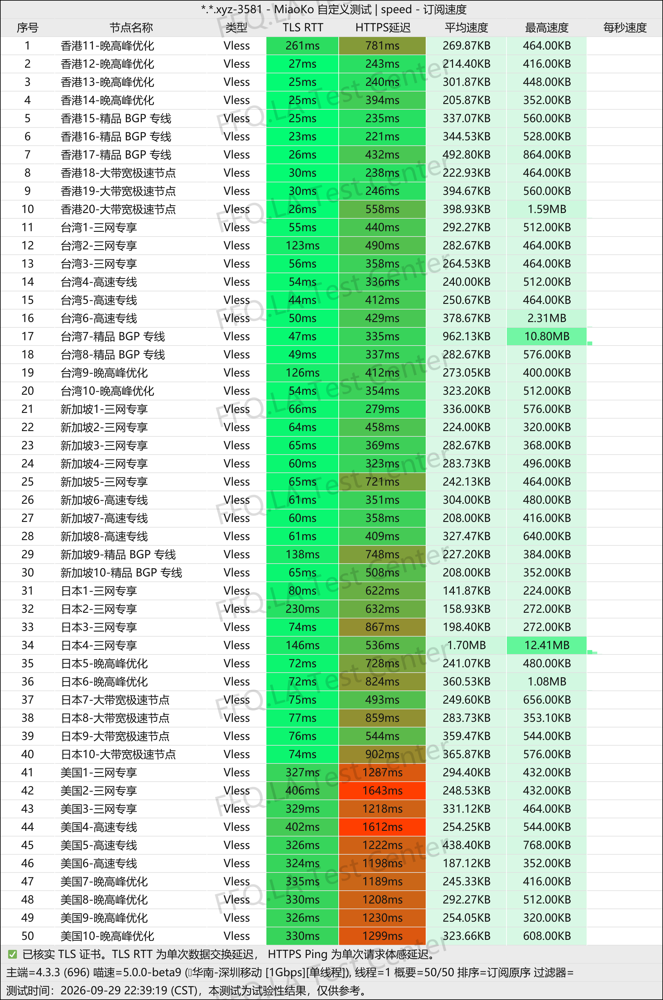
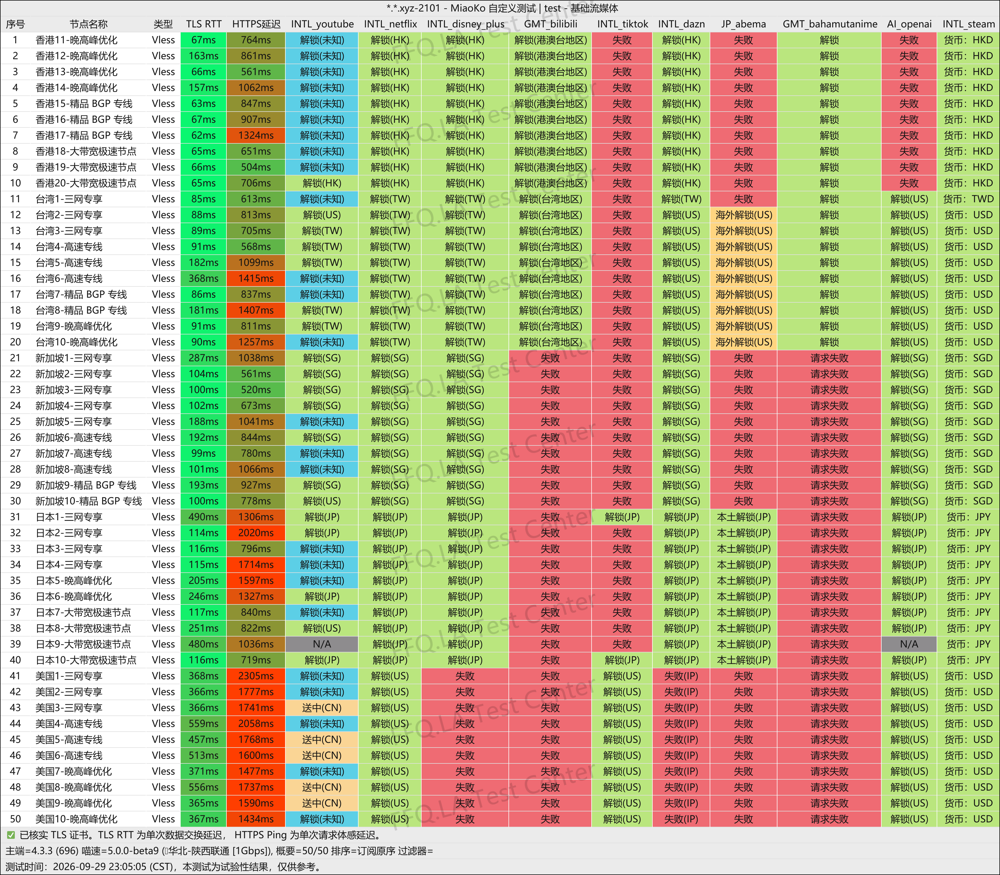
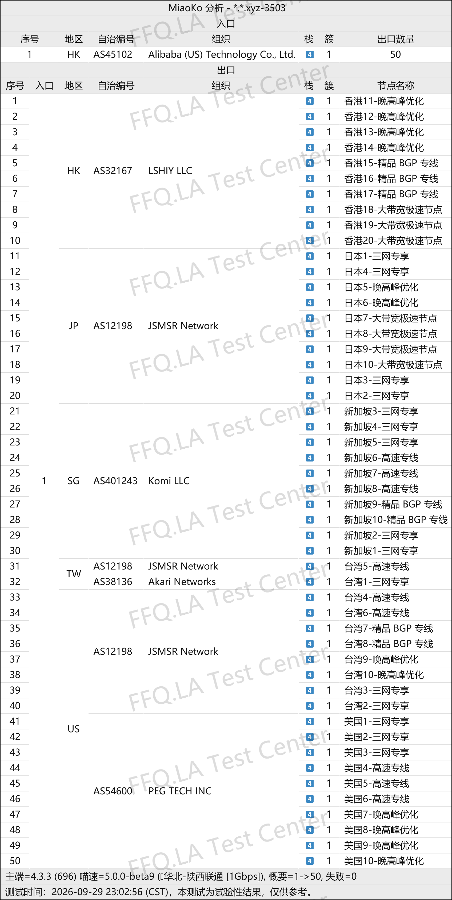

🇨🇳 [中文](README.md) | 🇺🇸 [English](README_EN.md) | 🇷🇺 Русский | 🇮🇷 [فارسی](README_FA.md)

# Официальный сайт ShenXing VPN (обновлено 13 ноября 2026)

Официальный сайт ShenXing VPN<br>
✅ Работает только через фирменное приложение<br>
Официальный адрес: [8538vip.shenxingaff.com](https://to.iix.im/sx01)<br>

Лучшие VPN-сервисы и прокси-серверы 2026 года: [https://github.com/jdnei/JiChangTuiJian](https://github.com/jdnei/JiChangTuiJian)<br>

## Telegram-сообщество VPN #AD

[Группа розыгрышей VPN](https://331024.de/archives/choujiang) | [Чат VPN](https://331024.de/archives/choujiang) | [Группа тестирования VPN](https://331024.de/archives/choujiang)<br>

[https://331024.de/archives/choujiang](https://331024.de/archives/choujiang)

## Пригласительный код

```bash
YpE2akcR
```

## Промокод / Код скидки

`Скидка 30%, срок действия неизвестен`

```bash
sx0077
```

## Описание

ShenXing VPN — сервис ускорения и защиты интернет-соединения, предназначенный для повседневного использования интернета, просмотра потокового видео и доступа к зарубежным онлайн-сервисам.

Сервис предоставляет серверы в различных регионах, включая Гонконг, Тайвань, Японию, Сингапур и США.

Тарифные планы рассчитаны как на небольшое, так и на интенсивное потребление трафика. Доступны ежемесячная и годовая оплата.

ShenXing подходит для индивидуальных пользователей, владельцев нескольких устройств и тех, кому требуется VPN для постоянного использования.

## Преимущества

ShenXing VPN делает акцент на выделенных каналах IPLC / IEPL. Все серверы используют коэффициент расхода трафика 1×, а тарифные планы не ограничивают количество устройств.

Предусмотрено несколько вариантов подписки с разными объёмами трафика.

Согласно некоторым опубликованным данным, пиковая скорость отдельного сервера может достигать 2,5 Гбит/с.

Сервис также поддерживает доступ к Netflix, Disney+, YouTube и популярным инструментам искусственного интеллекта, включая ChatGPT, Gemini и Claude.

ShenXing работает исключительно через `фирменное клиентское приложение`, что призвано повысить стабильность соединения.

## Тарифные планы

| Тариф | Трафик | Устройства | Скорость | Цена в месяц | Цена в год | Обновление трафика | Тип соединения | Серверы / Особенности | Для кого подходит |
|---|---:|---:|---:|---:|---:|---|---|---|---|
| ShenXing · Starter | 120 ГБ/мес. | Без ограничений | Без ограничений | ¥23 | — | Ежемесячно | Выделенные линии IPLC | Коэффициент трафика 1× на всех серверах; без ограничения скорости в вечерние часы пик; пиковая скорость одного сервера до 2,5 Гбит/с; нативные IP-адреса; Гонконг ×20, Тайвань ×10, Япония ×10, Сингапур ×10, США ×10 и другие регионы | Научные исследования, социальные сети, повседневное использование VPN, просмотр видео в 4K / HDR |
| ShenXing · Basic | 260 ГБ/мес. | Без ограничений | Без ограничений | ¥40 | — | Ежемесячно | Выделенные линии IPLC | Коэффициент трафика 1× на всех серверах; без ограничения скорости в вечерние часы пик; пиковая скорость одного сервера до 2,5 Гбит/с; нативные IP-адреса; Гонконг ×20, Тайвань ×10, Япония ×10, Сингапур ×10, США ×10 и другие регионы | Загрузка больших файлов, использование нескольких устройств и маршрутизация через программный роутер |
| ShenXing · Premium | 520 ГБ/мес. | Без ограничений | Без ограничений | ¥72 | — | Ежемесячно | Выделенные линии IPLC | Коэффициент трафика 1× на всех серверах; без ограничения скорости в вечерние часы пик; пиковая скорость одного сервера до 2,5 Гбит/с; нативные IP-адреса; Гонконг ×20, Тайвань ×10, Япония ×10, Сингапур ×10, США ×10 и другие регионы | Интенсивная загрузка файлов, маршрутизация нескольких устройств, требовательные онлайн-игры, студии и активные пользователи |
| ShenXing · Annual Special | 60 ГБ/мес. | Без ограничений | Без ограничений | — | ¥96 | Автоматически каждые 30 дней | Выделенные линии IEPL · VLESS | Коэффициент трафика 1× на всех серверах; без ограничения скорости в вечерние часы пик; нативные IP-адреса; более 50 серверов; поддержка Netflix, Disney+, YouTube и других сервисов | Пользователи с небольшим расходом трафика и новички; примерно ¥8 в месяц |

## 📊 Тестирование производительности и анализ

#### 1. Тест скорости в вечерние часы пик

<br>

#### 2. Отчёт о разблокировке стриминговых сервисов

<br>

#### 3. Анализ входных и выходных узлов

<br>
